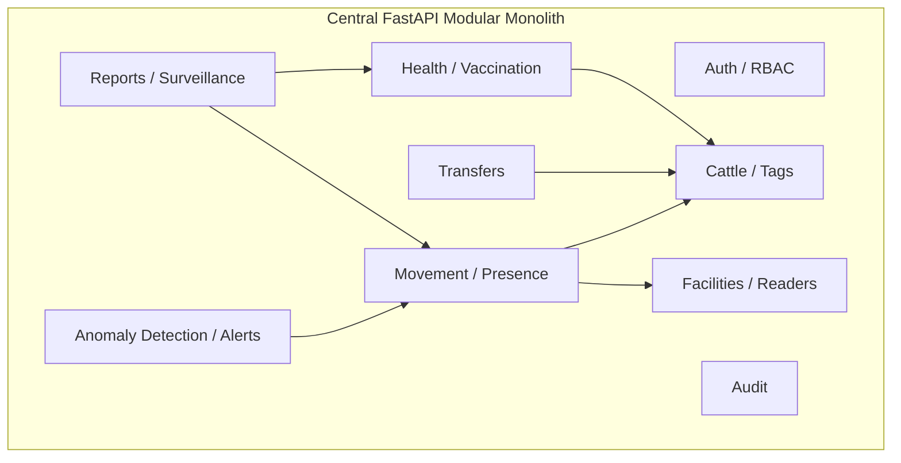
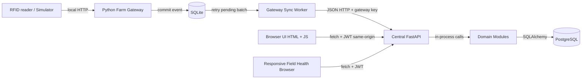
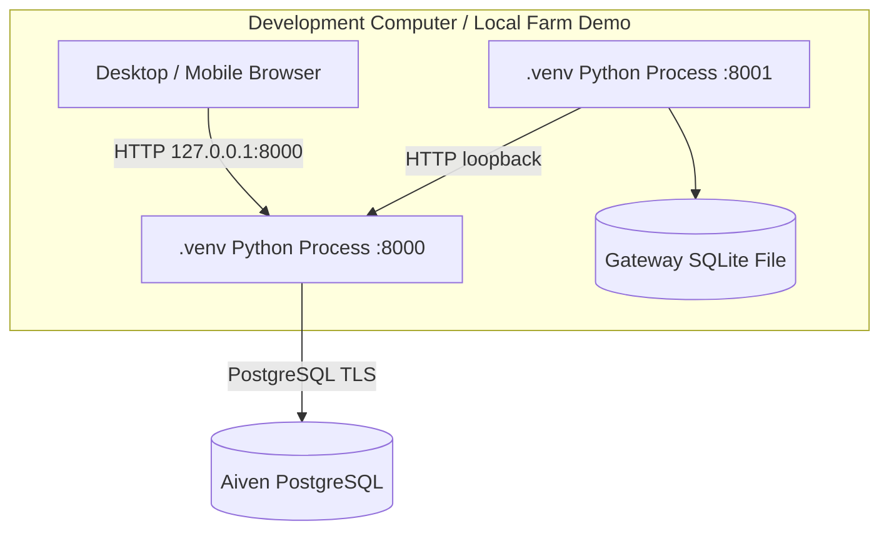

# VinaBeef M2 — Architecture (Local Python / HTML Edition)

**Architectural style retained from final M1:** Central **FastAPI Modular Monolith**, not Microservices and not a claim to have adopted all layers of Clean Architecture. The existing `backend/app/modules/*` packages are logical business modules. `edge_gateway/main.py` is a physically separate optional farm-side Python process for M2 network-outage handling.

**Implementation choices:** Python 3.11+, FastAPI, SQLAlchemy 2.x, Alembic, PostgreSQL (Aiven via `DATABASE_URL`), JWT/RBAC, HTML + CSS + plain JavaScript, SQLite gateway, Pytest + HTTPX. Deployment uses two local Python processes and one `.venv`; no Docker, React or mobile framework.

## Module View

Module boundaries and the existing FastAPI routers remain. Some persistence classes are still centralized under `app/db/models.py`; this is a known maintainability limitation, not proof of a fully isolated module design.

## Component-and-Connector View

A successful local gateway 202 response signifies durable local acceptance, **not** central Movement acceptance. The client sends the same event ID on retry to support idempotency. Central domain rules continue separating raw RFID evidence, accepted movements, and presence projection.

## Allocation View (local development)

A phone must use the PC LAN IP instead of loopback, with firewall and authentication considered. This **local** diagram does not claim production-grade device deployment or offline mobile storage guarantees. For actual farms the gateway must run near the devices. The central system of record remains PostgreSQL.

## ADR Delta vs the M1 Report

- **ADR-001:** Retain centralized Modular Monolith and explicit module boundaries.
- **ADR-002/003:** Retain raw RFID event vs accepted movement separation and truthful acknowledgement semantics.
- **ADR-005/006:** Retain JWT/RBAC and audit policies on the server.
- **ADR-007:** Keep external RFID and disease API adapters; real national integration still mocked.
- **ADR-008:** Implement farm-local Python SQLite gateway with eventual central replay.
- **UI technology adjustment:** Replace React + TS with direct FastAPI StaticFiles and `fetch()` JavaScript; this is a frontend implementation decision, **not** a change of central architecture style.
- **Mobile implementation adjustment:** Replace React Native/Expo with responsive `/field` browser UI. Keyboard-wedge RFID entry is demonstrable; mobile native RFID SDK is unavailable. Browser IndexedDB outbox is a teaching demo, not a secure health-record storage promise.

## SOLID evidence / limits

The central code retains small router modules, injectable FastAPI dependencies, and a dedicated movement service, but broad compliance with every SOLID principle is **not** fully demonstrated merely by the package structure. Pytest covers existing scenarios; additional repository contract tests and a PostgreSQL-backed integration test suite are recommended if required by the final report.
